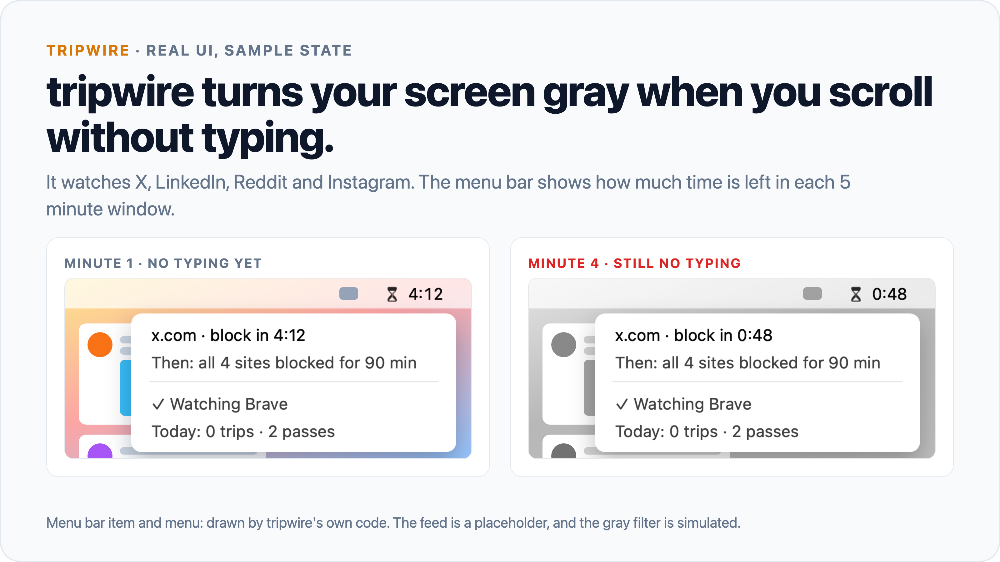
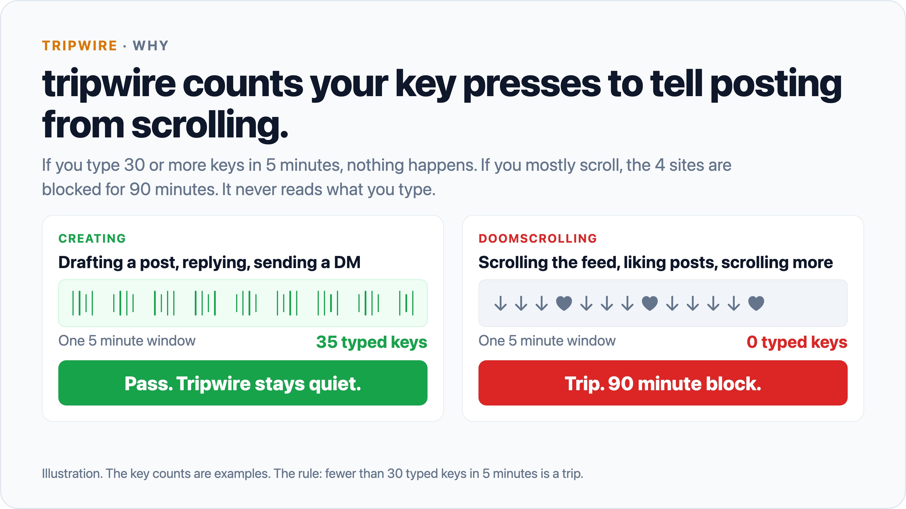
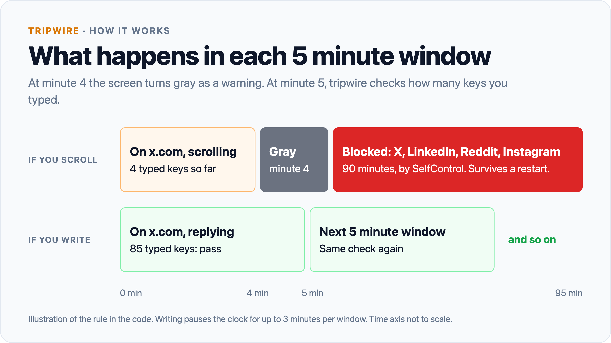
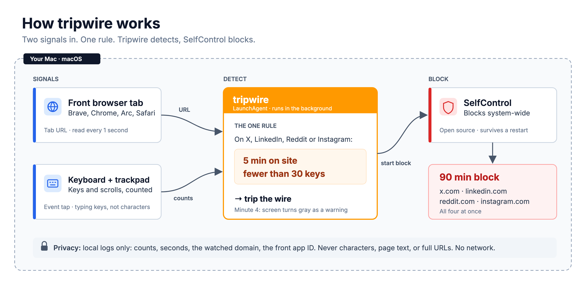

# tripwire

tripwire is a small macOS tool. It blocks X, LinkedIn, Reddit, and Instagram for 90 minutes when you scroll them without typing.

If you spend 5 minutes on one of those sites and type fewer than 30 keys, all four sites are blocked. If you write a post, a reply, or a DM, nothing happens.



```sh
git clone https://github.com/AaqifZ/tripwire.git
cd tripwire
scripts/install.sh
```

You also need [SelfControl](https://selfcontrolapp.com) and two macOS permissions. See [Requirements](#requirements).





## What it does

- **Watches the active browser window.** Once per second, tripwire reads the URL of the active tab in Brave, Chrome, Arc, or Safari.
- **Counts typing.** A macOS event tap counts typed keys and scrolls. Space, arrows, page keys, and cmd or ctrl shortcuts do not count as typing.
- **Trips on one rule.** 5 minutes on a watched site with fewer than 30 typed keys starts a block.
- **Hands the block to SelfControl.** SelfControl blocks all four sites system-wide for 90 minutes. The block survives a restart.
- **Warns without a dialog.** At minute 4, the whole screen turns gray. Type or leave the site, and the color comes back.
- **Pauses while you write.** Attributed typing on a watched site, or an open post composer, pauses the clock. The pause lasts 3 minutes at most per window.
- **Shows a countdown in the menu bar.** An hourglass shows the time left on a watched site. A lock shows the time left in a block. The menu has no Quit item.

Watched sites: x.com (and twitter.com), linkedin.com, reddit.com, instagram.com.

Tripwire has no schedules, budgets, dashboards, or rule modes. Each rule is one more thing to negotiate with. See [docs/DECISIONS.md](docs/DECISIONS.md), D1.

## Why

Some sites are work tools and traps at the same time. You open X to reply to one person. Forty minutes later you have written nothing.

Most blockers ask "which site, and for how long?" That forces a bad choice. Block the site and you lose a work tool. Allow it and you lose the evening.

Tripwire watches behavior instead. Doomscrolling has a clear signature: a lot of input and no output. You scroll and you like, but you do not type. Tripwire looks for that signature and nothing else.

## Install

### Requirements

- macOS 13 or later.
- Swift 5.9 or later. The Xcode Command Line Tools are enough (`xcode-select --install`).
- [SelfControl](https://selfcontrolapp.com) in `/Applications`. Tested with SelfControl 4.0.2. To install it with Homebrew: `brew install --cask selfcontrol`.
- Brave, Chrome, Arc, or Safari. The block also covers Firefox, but tripwire cannot read a Firefox tab.
- Two macOS permissions for the tripwire binary:
  - **Input Monitoring**, to count keys and scrolls.
  - **Automation**, one grant per browser, to read the URL of the front tab.
- An admin password, one time, for `scripts/root-setup.sh`. Without that step, a trip cannot block.

### What the install script does

Run the three commands at the top of this page. `scripts/install.sh` does these steps:

1. Builds tripwire with `swift build -c release`.
2. Copies the binary to `~/.local/bin/tripwire`.
3. On the first install, runs `scripts/make-signing-cert.sh`. This script adds a self-signed code-signing certificate, `tripwire-local`, to your login keychain. macOS ties the Input Monitoring grant to the binary signature, so a fixed certificate keeps the grant when you rebuild. If the script fails, install.sh uses an ad-hoc signature, and each rebuild asks for Input Monitoring again.
4. Writes the LaunchAgent `~/Library/LaunchAgents/com.aaqifz.tripwire.plist` and loads it with `launchctl`. launchd starts tripwire at login and restarts it if it stops.
5. Makes the folder `~/.tripwire` for the logs.

After the install:

1. Turn on tripwire in System Settings > Privacy & Security > Input Monitoring. launchd restarts tripwire in about 30 seconds.
2. Open a watched site in your browser. Click Allow when macOS asks if tripwire can control the browser.
3. Run `sudo scripts/root-setup.sh install` one time. A trip then starts its block with no password dialog. Run it again after a SelfControl update.
4. Run the install script again after each code change.

To try the rule without a real block, use test mode. The window is 30 seconds, the screen turns gray at 20 seconds, and a trip goes in the log with no block:

```sh
scripts/install.sh --test
```

Run `scripts/install.sh` again to go back to real mode.

To remove tripwire:

```sh
scripts/uninstall.sh
sudo scripts/root-setup.sh remove
```

The uninstall script stops tripwire and removes the LaunchAgent and the binary. It keeps `~/.tripwire` and the `tripwire-local` certificate. It does not stop a block that runs. To remove the certificate, delete `tripwire-local` in Keychain Access.

## Use

Tripwire runs in the background. You do not start it.

To see its state, run:

```sh
~/.local/bin/tripwire status
```

(If `~/.local/bin` is on your `PATH`, `tripwire status` is enough.)

The output shows:

- the daemon heartbeat. `STOPPED or FROZEN` means the tick stopped.
- detection. `BLIND` means tripwire cannot read the browser tab for 60 seconds or more.
- the block end time, if a block runs.
- today's trips, passes, and windows left early, and the last 5 log lines.

| Command | What it does |
| --- | --- |
| `tripwire run` | Watch and block. The LaunchAgent runs this command. |
| `tripwire run --test` | Use a 30 s window and log a trip, with no block. |
| `tripwire status` | Show the heartbeat, detection, block, and today's results. |
| `tripwire snapshot DIR` | Draw the menu bar item and menu with sample states to PNG files. Touches no live state. |

### If something is wrong

- **`STOPPED or FROZEN`:** run `scripts/install.sh` again, then read `~/.tripwire/tripwire.err`.
- **`BLIND`:** check System Settings > Privacy & Security > Automation. Tripwire must be allowed to control your browser.
- **No hourglass in the menu bar:** a menu bar manager can hide it. Move the item to the visible part of the menu bar.

## How it works



1. Tripwire reads the active browser tab and the browser window that receives a scroll event. It asks that browser process by its PID, so a hidden copy of the same browser cannot answer for it.
2. If the URL is on a watched site, the 5 minute window clock runs.
3. The event tap adds input attributed to that window. Unrelated input receives no credit.
4. At 4 minutes with fewer than 30 typed keys, the screen turns gray.
5. At 5 minutes, tripwire gives a verdict. Fewer than 30 typed keys is a trip. Otherwise the window passes and a new one starts.
6. On a trip, tripwire calls the SelfControl CLI to block all watched sites for 90 minutes.

If you leave the watched sites for 5 minutes, the window resets. Tripwire detects. SelfControl blocks. Tripwire has no blocker of its own and no browser extension.

The code is one Swift package with no dependencies:

- `Sources/TripwireCore`: the rule, attribution model, enforcement state, process adapter, and logs.
- `Sources/tripwire`: the daemon, the event tap, the tab reader, the gray screen, and the menu bar item.
- `Sources/TripwireSelfTest`: the tests, as an executable. Run `swift run TripwireSelfTest`.

[docs/DECISIONS.md](docs/DECISIONS.md) explains each design decision. The code refers to the decisions by ID (D1 to D25).

### Privacy

Tripwire runs on your Mac only. It makes no network calls of its own.

What it reads, and keeps in memory only:

- the URL of a browser tab that is active or receives a scroll event.
- the key class, destination process, event time, and scroll window ID. Tripwire uses these only to attribute input. It never reads the character or a window title.
- a bounded in-memory event buffer. It discards the buffer after each observation.

What it writes to `~/.tripwire`:

- `events.log`: one line per window. The line has the time, the result (`pass`, `trip`, or `abandon`), the typed-key and scroll counts, the seconds with the clock paused, the watched domain, and whether a block started. A window left early also has its seconds on the site.
- `tripwire.err`: the daemon log, with times. It records when you arrive on a watched domain, and the bundle ID of the front app when you leave the watched sites (for example `com.apple.Safari`). It also records writing pauses, trips, and detection errors.
- Small state files: `heartbeat`, `runtime.json`, `enforcement.json`, `blind`, `gray-on`, and `blocklist.selfcontrol`.

Tripwire never stores characters, keycodes, page content, or full URLs. The logs are never deleted automatically. To remove them, delete `~/.tripwire`.

## Limits

- An admin can unload the LaunchAgent or stop the process. The goal is friction, not impossibility.
- The gray screen uses a private macOS call. A macOS update can remove it. The block still works without it.
- Tripwire cannot read a Firefox tab. A SelfControl block still covers Firefox.
- Tripwire cannot see if a text field has focus. Letter keys that a site uses for navigation (j and k on X) count as typing.
- Long reading with no typing trips the block. This is a known false positive, and the cost is a 90 minute break.
- Only the four watched sites are supported. To change them, edit `Sources/TripwireCore/Sites.swift` and reinstall.

## License

MIT. See [LICENSE](LICENSE).

Tripwire uses [SelfControl](https://github.com/SelfControlApp/selfcontrol) for the block. SelfControl is a separate open-source app (GPL-3.0). Tripwire calls its CLI and does not include its code.

Built with AI coding agents.


## Reliability candidate: 0.2.1

Background hover scroll selects the receiving browser window, even when another app has focus. When macOS omits the event-window ID, Tripwire requires the same frontmost window in the snapshots before and after the event. Browser windows still require a unique process and bounds match. Conflicting identity fails closed.

Typing receives credit only after stable observations of the same watched window. Unrelated apps, function keys, media keys, and key repeat receive no credit. Unknown activity preserves the countdown without a verdict. The menu shows a detection failure.

A trip remains pending across failed commands and daemon restarts. Tripwire verifies the block's domains and end time. An unrelated SelfControl block does not satisfy the trip. SelfControl cannot extend an existing block through its CLI, so a conflict remains visible until it can resolve.

The installer stages and signs the candidate before it stops the service. It uses atomic file replacements and restores the previous installation after failure. It retains recovery files if rollback fails.

To inspect attribution without a block or gray screen:

```sh
tripwire probe 15
```

To run the regression checks:

```sh
swift run TripwireSelfTest
scripts/tests/install-test.sh
```

If a managed environment prevents SwiftPM's nested sandbox, use its explicit manifest option within the existing outer sandbox:

```sh
swift run --disable-sandbox TripwireSelfTest
TRIPWIRE_SWIFTPM_DISABLE_SANDBOX=1 scripts/install.sh
```

This option does not grant LaunchAgent control or Input Monitoring access. Installed 0.2.1 passed the Slack-focused, background-X hover-scroll test. Firefox detection, transparent click-through overlays, browser API changes, and deliberate administrator bypass remain limitations.
